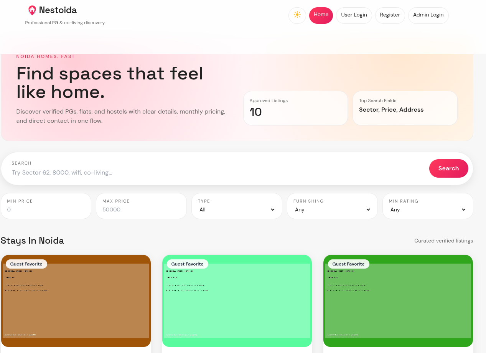

diff --git a/README.md b/README.md
index b3b1ead..d32789a 100644
--- a/README.md
+++ b/README.md
@@ -1,26 +1,31 @@
 # Satyam Mall
 
-B.Tech CSE student focused on DSA and full‑stack web development.
+B.Tech CSE student at G.L. Bajaj Institute of Technology and Management, focused on DSA and full‑stack web development.
 
 ---
 
 ## About
 - B.Tech in Computer Science and Engineering
-- Daily DSA practice with a focus on problem‑solving
-- Building full‑stack projects and backend fundamentals
+- Daily DSA practice in C++ with a focus on problem‑solving (130+ LeetCode solutions and a growing [DSA notes repo](https://github.com/satyamhub/DSA))
+- Building and shipping full‑stack projects, from a campus marketplace to an appointment system
+- Exploring AI agents and graph analytics through hackathon and side projects
 - Goal: product‑based engineering roles and impactful work
 
 ---
 
 ## Tech Stack
 

-  
+  
 

 
 ---
 
 ## Projects
-- Nestoida — Rental listing platform for PGs, flats, hostels, and co‑living spaces in Noida. `PHP · JavaScript · HTML · CSS` • [Repo](https://github.com/satyamhub/Nestoida)
+- **PeerKart × G.L. Bajaj** — Campus marketplace for students to buy, sell, and pass on books, gadgets, and essentials. Web app plus Android APK releases. [Live](https://glbpeerkart.netlify.app) • [Repo](https://github.com/satyamhub/PeerKart-x-GL-Bajaj)
+- **HealSync** — Hospital doctor–patient appointment management with role-based auth, doctor availability and slots, and double-booking prevention. `Next.js · TypeScript · Tailwind CSS · Prisma · PostgreSQL` • [Repo](https://github.com/satyamhub/HealSync)
+- **Cloudforce Fraud Ring** — TigerGraph-powered fraud detection demo that expands one suspicious account into a full mule ring (Devacation 2026). `TigerGraph · Flask · HTML` • [Live](https://cloudforce.vercel.app/) • [Repo](https://github.com/satyamhub/cloudforce-fraud-ring)
+- **DeskPilot** — AI autopilot that turns natural language into browser automation, running fully locally. `Python · Ollama · Playwright` • [Repo](https://github.com/satyamhub/deskpilot)
+- **Nestoida** — Rental listing platform for PGs, flats, hostels, and co‑living spaces in Noida. `PHP · JavaScript · HTML · CSS` • [Repo](https://github.com/satyamhub/Nestoida)
 
 ---
 
@@ -36,14 +41,15 @@ B.Tech CSE student focused on DSA and full‑stack web development.
 ---
 
 ## Current Focus
-- DSA and problem‑solving consistency
+- DSA and problem‑solving consistency in C++
+- Full‑stack development with Next.js, TypeScript, and Prisma
 - Backend development and system fundamentals
-- Real‑world full‑stack projects
+- Shipping real‑world projects with real users
 
 ---
 
 ## 2026 Goals
-- Solve 300+ DSA problems
+- Solve 300+ DSA problems (130+ done in my LeetCode repo so far)
 - Secure an internship in a product‑based company
 - Build 3 full‑stack projects end‑to‑end
 
diff --git a/index.html b/index.html
index 3ab2430..bcf54be 100644
--- a/index.html
+++ b/index.html
@@ -58,7 +58,7 @@
       

         

           Primary Stack
-          PHP • JS • MySQL
+          JS • TS • PHP • Python
         

         

           Focus
@@ -284,7 +284,7 @@
     <section id="projects" class="section">
       

         <h2>Projects</h2>
-        
Selected work showcasing full‑stack and backend fundamentals.

+        
Selected work across full‑stack web, mobile releases, AI agents, and graph analytics.

       

       

         
@@ -312,6 +312,38 @@
           

         

       

+      

+        

+          <h3>PeerKart × G.L. Bajaj</h3>
+          
Campus marketplace where students buy, sell, and pass on books, gadgets, and essentials. Available on the web and as Android APK releases.

+          
WebAndroid

+          
<a class="btn small" href="https://github.com/satyamhub/PeerKart-x-GL-Bajaj" target="_blank" rel="noopener">Repository</a><a class="btn small" href="https://glbpeerkart.netlify.app" target="_blank" rel="noopener">Live</a>

+        

+      

+      

+        

+          <h3>HealSync</h3>
+          
Hospital appointment management with patient, doctor, and admin roles, doctor availability and slot generation, and database-level double-booking prevention.

+          
Next.jsTypeScriptTailwind CSSPrismaPostgreSQL

+          
<a class="btn small" href="https://github.com/satyamhub/HealSync" target="_blank" rel="noopener">Repository</a>

+        

+      

+      

+        

+          <h3>Cloudforce Fraud Ring</h3>
+          
TigerGraph-powered fraud detection demo that turns one suspicious account into a full mule ring with explainable graph queries. Built for Devacation 2026.

+          
TigerGraphFlaskHTML

+          
<a class="btn small" href="https://github.com/satyamhub/cloudforce-fraud-ring" target="_blank" rel="noopener">Repository</a><a class="btn small" href="https://cloudforce.vercel.app/" target="_blank" rel="noopener">Live</a>

+        

+      

+      

+        

+          <h3>DeskPilot</h3>
+          
AI autopilot that converts natural language commands into browser automation, running entirely on a local LLM.

+          
PythonOllamaPlaywright

+          
<a class="btn small" href="https://github.com/satyamhub/deskpilot" target="_blank" rel="noopener">Repository</a>

+        

+      

     </section>
 
     <section id="resume" class="section alt">
